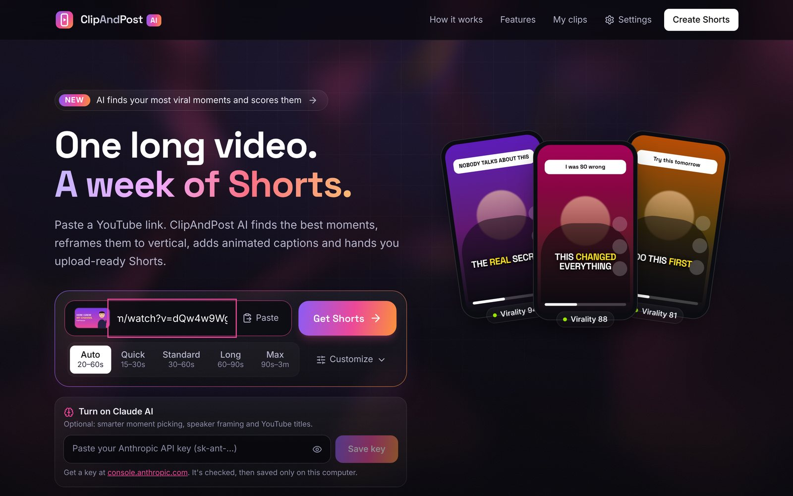
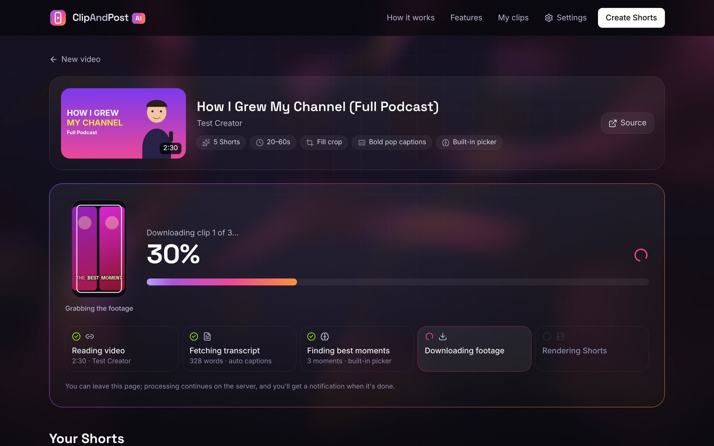
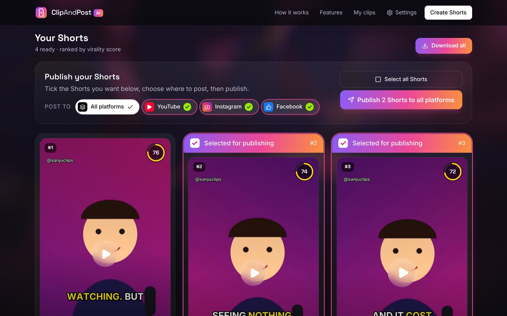
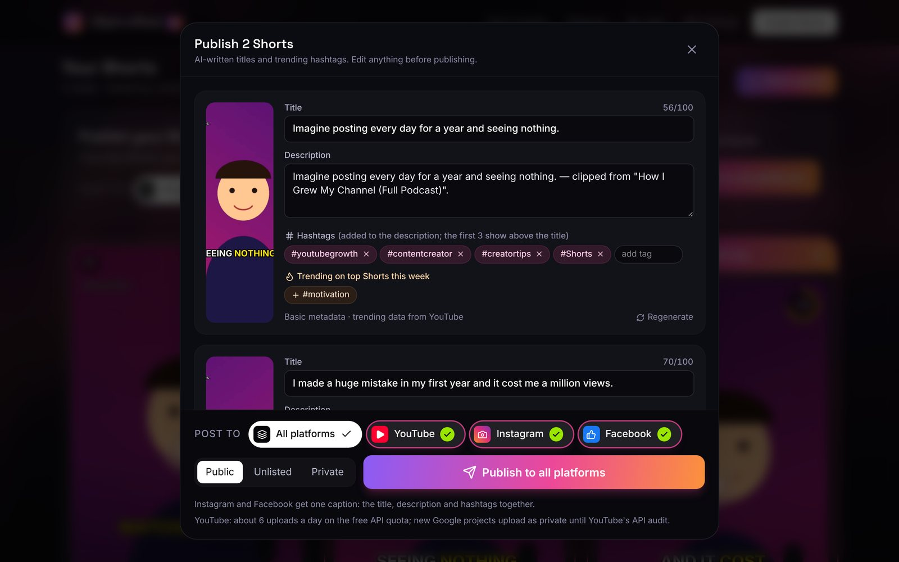
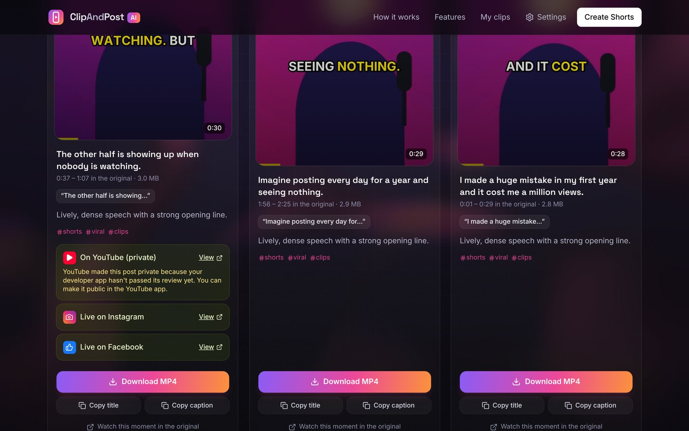
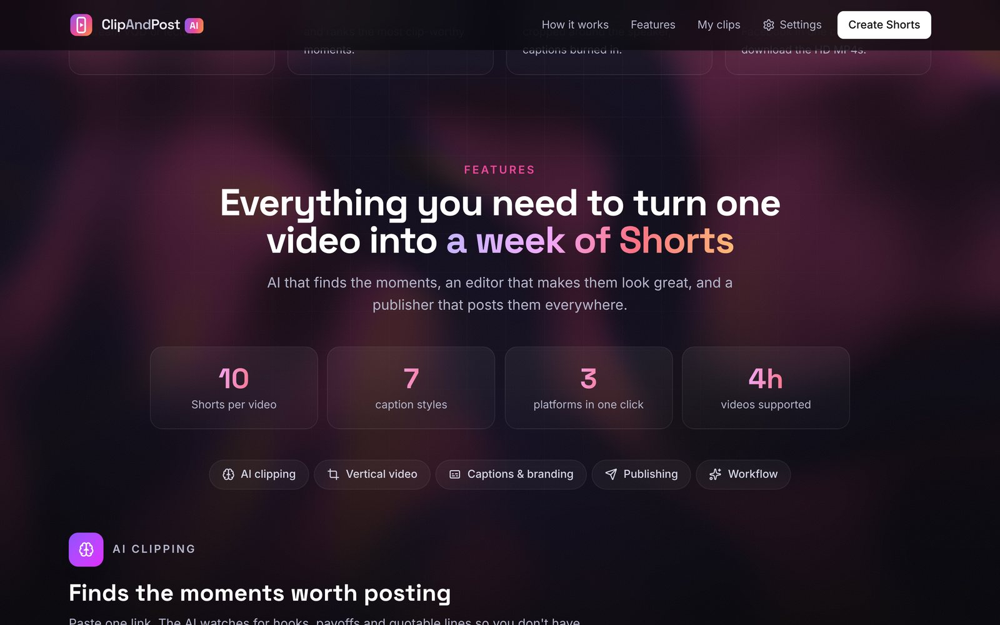
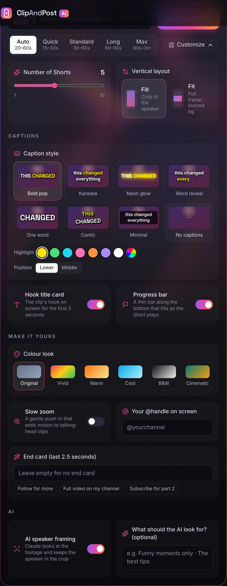
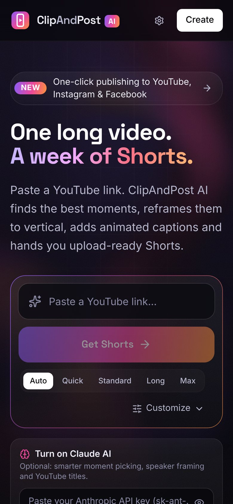
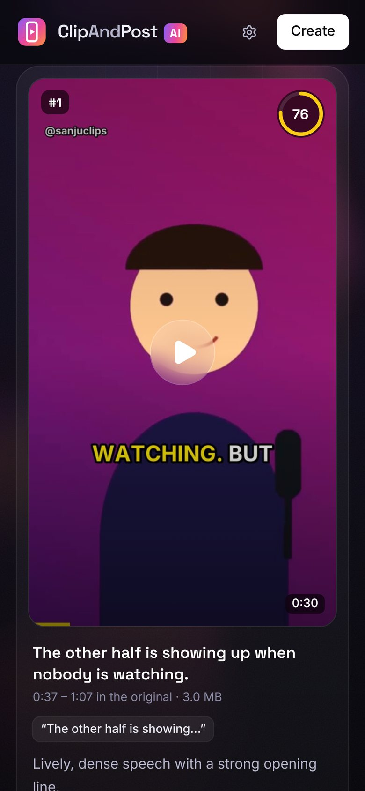
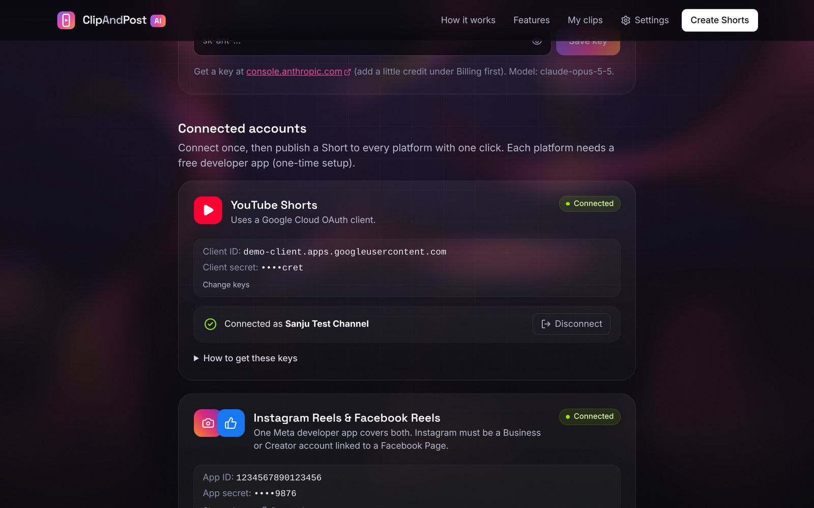

# ClipAndPost AI

**Paste a YouTube link. Get scroll-stopping Shorts. Publish them everywhere in one click.**

ClipAndPost AI finds the best moments in any long video and turns them into vertical 1080×1920 Shorts. Each one gets animated captions, a hook title card and a virality score. You can then publish them to **YouTube Shorts, Instagram Reels and Facebook Reels** with AI-written titles and trending hashtags.



<table>
  <tr>
    <td width="50%"></td>
    <td width="50%"></td>
  </tr>
  <tr>
    <td><b>Live progress.</b> An animated preview shows every step while your Shorts are made.</td>
    <td><b>Pick and publish.</b> Tick the Shorts you want and choose one platform or all of them.</td>
  </tr>
  <tr>
    <td width="50%"></td>
    <td width="50%"></td>
  </tr>
  <tr>
    <td><b>AI titles and trending hashtags.</b> Review and edit everything before posting.</td>
    <td><b>Live everywhere.</b> Each Short shows where it's published, with View links.</td>
  </tr>
</table>

---

## Contents

- [Features](#features)
- [Install it with Claude (easiest)](#install-it-with-claude-easiest)
- [Install it yourself](#install-it-yourself)
- [First-time setup](#first-time-setup)
- [Connect YouTube, Instagram and Facebook](#connect-youtube-instagram-and-facebook)
- [Troubleshooting](#troubleshooting)
- [Configuration](#configuration)
- [How it's built](#how-its-built)

---

## Features



### AI clipping
- **AI moment detection.** Claude reads the full transcript and picks self-contained moments with a strong hook and a real payoff.
- **Virality score.** Every Short is scored 0–100 with a one-line reason, so you post the best ones first.
- **Tell the AI what you want.** For example "funny moments only", "the best tips" or "skip the sponsor".
- **Clean cuts.** Clips always start and end on full sentences.
- **Up to 10 Shorts per video,** from 15 seconds up to YouTube's 3-minute limit.
- **Fast on long videos.** Only the clip sections are downloaded, so a 3-hour podcast takes minutes.
- **Works without AI too.** A built-in picker scores speech density, hook words and audio energy.

### Vertical video
- **AI speaker framing.** The AI looks at the footage and keeps the person talking in the 9:16 crop.
- **Layouts.** *Fill* crops to full-screen vertical; *Fit* shows the whole frame over a blurred background.
- **Colour looks:** Vivid, Warm, Cool, B&W and Cinematic.
- **Slow zoom** and a **progress bar** keep viewers watching.
- **Audio levelled** to −14 LUFS, the loudness YouTube plays Shorts at.
- **1080×1920 HD** H.264 MP4 export.

### Captions & branding
- **7 animated caption styles:** Bold pop, Karaoke, Neon glow, Word reveal, One word, Comic and Minimal, each synced word by word.
- **Any highlight colour,** with captions in the lower third or the middle.
- **Hook title card** for the first three seconds.
- **Your @handle** on every Short, and an **end card** such as "Follow for more".
- **Remembers your style,** so every video matches your channel.



### Publishing
- **YouTube Shorts, Instagram Reels and Facebook Reels** in one click: all at once, or just one.
- **AI-written titles and descriptions** for every Short.
- **Trending hashtags,** taken from this week's most-viewed Shorts on the same topic.
- **Review before posting:** edit anything, and choose public, unlisted or private on YouTube.
- **Never posts the same Short twice** to one platform.
- **Notifications:** pop-ups when your Shorts are ready and when each platform goes live, plus a desktop alert if you're in another tab.

### Workflow
- **Live progress** for each step: reading, transcript, finding moments, downloading and rendering.
- **Download** one MP4 or all of them, and **copy** titles and captions in one click.
- **Your library** of every video you've clipped.
- **Works on any device,** including your phone.
- **Private by design.** It runs on your own computer, and your videos and API keys stay there.
- **Easy setup.** Paste keys in Settings, where they're checked instantly, with step-by-step guides for every platform.

<p align="center">
  
  &nbsp;&nbsp;
  
</p>

---

## Install it with Claude (easiest)

Claude Code can install everything for you, including Node.js, ffmpeg, yt-dlp and the app itself, and start the site. ClipAndPost AI is free and open source, so no GitHub account is needed.

**1. Get Claude Code.** Use either of these:
- the **Claude desktop app** from [claude.ai/download](https://claude.ai/download), then open its **Code** tab and choose a folder on your computer to work in
- the **terminal version**, by following the install guide at [code.claude.com/docs](https://code.claude.com/docs)

**2. Paste this message into Claude Code:**

```text
Install and run ClipAndPost AI on this computer:

1. Clone https://github.com/Sanju07sr/ClipAndPost-AI into my home folder.
2. Install what it needs, using my system's package manager:
   Node.js 20 or newer, yt-dlp, deno, and ffmpeg WITH libass (captions).
   On macOS use Homebrew, and install ffmpeg from the homebrew-ffmpeg tap:
   brew tap homebrew-ffmpeg/ffmpeg && brew install homebrew-ffmpeg/ffmpeg/ffmpeg
3. In the project folder run: npm install, then npm run doctor, and fix
   anything doctor marks with ✘.
4. Start it with npm run dev and tell me the link to open.
Ask me before installing anything system-wide.
```

**3. Open the link.** Claude will give you **http://localhost:3000**.

Claude asks before installing each tool. Approve the steps you're happy with. You'll be asked for your Mac or PC password once when system tools are installed.

---

## Install it yourself

### What you need

| Tool | Why |
|---|---|
| **Node.js 20+** | Runs the website |
| **ffmpeg** with **libass** | Cuts the video and draws the captions |
| **yt-dlp** | Reads YouTube videos and captions |
| **deno** (recommended) | Helps yt-dlp read YouTube reliably |
| **Git** | Downloads the code |

### macOS

```bash
brew install node git yt-dlp deno
```
```bash
brew tap homebrew-ffmpeg/ffmpeg && brew install homebrew-ffmpeg/ffmpeg/ffmpeg
```

No Homebrew yet? Install it from [brew.sh](https://brew.sh) first. The second command installs a full ffmpeg build with caption support, because Homebrew's default ffmpeg may leave libass out.

### Windows

```bash
winget install OpenJS.NodeJS.LTS Git.Git Gyan.FFmpeg yt-dlp.yt-dlp DenoLand.Deno
```

Close and reopen PowerShell afterwards so the new tools are found.

### Ubuntu / Debian

```bash
sudo apt install git ffmpeg python3-pip && pip install -U "yt-dlp[default]"
```

Install Node.js 20 or newer from [nodejs.org](https://nodejs.org); the version in older Ubuntu releases is too old.
```bash
curl -fsSL https://deno.land/install.sh | sh
```

### Download and start

```bash
git clone https://github.com/Sanju07sr/ClipAndPost-AI.git
```
```bash
cd ClipAndPost-AI && npm install
```
```bash
npm run doctor
```
```bash
npm run dev
```

Open **http://localhost:3000**. `npm run doctor` shows a ✔ or ✘ for each tool, so you know exactly what's missing.

**Updating later:** stop the site with Control + C, then run `git pull && npm install && npm run dev`.

**Production:** run `npm run build && npm start`, or use Docker:

```bash
docker build -t clipandpost . && docker run -p 3000:3000 -v clipandpost-data:/data clipandpost
```

---

## First-time setup

Everything is done in the website. Nothing needs editing in files.

1. **Turn on the AI (optional but recommended).**
   - Get a key at [console.anthropic.com](https://console.anthropic.com/settings/keys) after adding a little credit under Billing.
   - Paste it in the **Turn on Claude AI** box under the link field, or in **Settings**.
   - Without a key, the site still works using its built-in picker.
2. **Paste a YouTube link** and click **Get Shorts**. Open **Customize** to choose caption style, colours, length, look and branding.
3. **Connect your accounts** in **Settings** to publish (see below).



---

## Connect YouTube, Instagram and Facebook

Each platform needs a free developer app, set up once. The **Settings** page has a step-by-step guide for each one, with the exact redirect addresses to copy.

### YouTube Shorts (about 5 minutes)

1. In [Google Cloud Console](https://console.cloud.google.com/projectcreate), create a project and enable the **YouTube Data API v3**.
2. Under **Google Auth Platform**, set the consent screen to *External* and add your Google account as a *Test user*.
3. Create an **OAuth client** of type *Web application*, with the redirect URI `http://localhost:3000/api/youtube/callback`.
4. Paste the client ID and secret in **Settings → YouTube Shorts**, then click **Connect YouTube**.

Good to know:
- **Private until audited.** YouTube makes uploads from new Google projects *private* until the project passes YouTube's [API audit](https://support.google.com/youtube/contact/yt_api_form). The site tells you when this happens, and you can make videos public in YouTube Studio.
- **About 6 uploads a day** on the free API quota.
- **Weekly reconnect** while the consent screen is in *Testing*.

### Instagram Reels & Facebook Reels (about 10–15 minutes)

1. **Instagram:** switch it to a Business or Creator account and link it to your Facebook Page.
2. **Meta developer account:** open [developers.facebook.com](https://developers.facebook.com), click **Log in**, then **Get Started** to register as a developer.
3. **Create the app:** **My Apps → Create App**, with the use cases *Manage everything on your Page* and *Manage messaging & content on Instagram*.
4. **Permissions:** add `pages_manage_posts`, `pages_read_engagement`, `instagram_basic` and `instagram_content_publish`. Choose *API setup with Facebook login* for Instagram.
5. **Redirect address:** add `http://localhost:3000/api/connect/meta/callback` under **Facebook Login for Business → Settings**.
6. **Configuration ID:** create one under **Facebook Login for Business → Configurations**.
7. **Connect:** paste the **App ID**, **App secret** and **Configuration ID** in **Settings**, then click **Connect Instagram & Facebook**.

The Settings page explains each click. While the Meta app is in *Development* mode, Meta shows its posts only to you, so switch it to *Live* when you're ready.

---

## Troubleshooting

| Problem | Fix |
|---|---|
| "yt-dlp is not installed" | Install yt-dlp, then close and reopen the terminal. Run `npm run doctor` to check. |
| Shorts have no captions | Your ffmpeg lacks libass. On macOS, install the full build (see [macOS](#macos)). |
| "Sign in to confirm you're not a bot" | Export your YouTube cookies to `cookies.txt` (with a "Get cookies.txt" browser extension), set `YTDLP_COOKIES=./cookies.txt` in `.env.local`, and keep yt-dlp updated (`yt-dlp -U`). |
| Google says "access_denied" | Add your Google account as a **Test user** in Google Auth Platform → Audience. |
| "YouTube Data API v3 has not been used…" | Enable the API for your project and wait a few minutes. |
| Meta developer page says "Page Not Found" | Log in at developers.facebook.com first, in Chrome or Safari rather than the Facebook app. |
| `git pull` refuses to update | Run `git stash && git pull`. |

---

## Configuration

Keys are easiest to add on the **Settings** page. They're checked before saving and stored only on your computer, in `data/settings.json`. Every setting can also be an environment variable in `.env.local`; see `.env.example` for the full list.

| Variable | Default | Purpose |
|---|---|---|
| `ANTHROPIC_API_KEY` | none | Turns on the AI features |
| `CLAUDE_MODEL` | `claude-opus-5-5` | Model used for the AI steps |
| `CLAUDE_EFFORT` | `medium` | How hard Claude thinks (`low` … `max`) |
| `GOOGLE_CLIENT_ID` / `GOOGLE_CLIENT_SECRET` | none | YouTube publishing |
| `META_APP_ID` / `META_APP_SECRET` / `META_CONFIG_ID` | none | Instagram and Facebook publishing |
| `APP_URL` | `http://localhost:3000` | Base address used for sign-in redirects |
| `YTDLP_COOKIES` | none | Path to a `cookies.txt` |
| `DATA_DIR` | `./data` | Where videos, Shorts and settings are stored |
| `MAX_CONCURRENT_JOBS` | `1` | Videos processed at the same time |
| `FULL_DOWNLOAD` | `0` | `1` downloads whole videos instead of clip sections |

---

## How it's built

- **Next.js** (App Router) and **Tailwind CSS**, with a WebGL animated background.
- **ffmpeg** for cutting, reframing, colour looks and captions (ASS via libass).
- **yt-dlp** for video and caption downloads.
- **Claude** through the official `@anthropic-ai/sdk`. It uses structured outputs for moment picking, framing and metadata, with server-side fallback.
- **Official platform APIs:** the YouTube Data API (resumable uploads) and the Meta Graph API v27.0 (Instagram and Facebook Reels resumable uploads).
- **Background job queue** in the Node server, with jobs saved to `DATA_DIR/jobs/<id>/job.json`.

| Path | What's in it |
|---|---|
| `lib/pipeline.ts` | The five processing stages and the job queue |
| `lib/youtube.ts` | yt-dlp: metadata, captions, section downloads |
| `lib/ai.ts` | Claude: moment picking, speaker framing, Shorts metadata |
| `lib/moments.ts` | Built-in picker, sentence snapping, overlap removal |
| `lib/captions.ts` | Animated caption styles, hook card, handle and end card |
| `lib/media.ts` | ffmpeg: reframing, looks, zoom, progress bar, rendering |
| `lib/publish.ts` | Trending hashtags, metadata, upload queue, YouTube uploads |
| `lib/platforms/meta.ts` | Facebook Login, Instagram Reels and Facebook Reels |
| `lib/google.ts` | Google OAuth for YouTube |
| `app/api/*` | REST API |
| `components/*` | UI |

### API

| Method | Path | What it does |
|---|---|---|
| `POST` | `/api/jobs` | Starts a job. Returns `{ id }`. |
| `GET` | `/api/jobs/:id` | Job status, progress, clips and upload states |
| `GET` | `/api/jobs/:id/clips/:clipId` | The MP4 (`?download=1` to download) |
| `DELETE` | `/api/jobs/:id` | Deletes a finished job and its files |
| `POST` | `/api/jobs/:id/clips/:clipId/metadata` | AI title, description and trending hashtags |
| `POST` | `/api/jobs/:id/publish` | Body: `{ items: [{ clipId, title, description, hashtags, privacy }], platforms: ["youtube","instagram","facebook"] }` |
| `GET` | `/api/connections` | Which platforms are set up and connected |
| `GET`/`POST` | `/api/settings` | Read (masked) or save keys |

---

## License

ClipAndPost AI is free and open source under the [MIT License](LICENSE). You can use, modify and share it; just keep the copyright notice.

## Please note

Only clip videos you own or have permission to reuse. Downloading YouTube content may be restricted by YouTube's Terms of Service, and each platform's own rules apply to what you publish.
